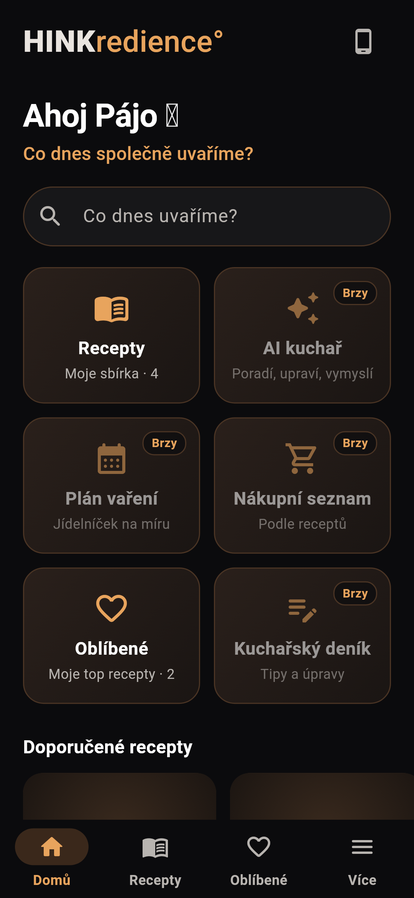

# HINKredience°

**Dvě hlavy. Jedna dokonalá chuť.**

Osobní inteligentní kuchařka Pavla Hinka pro Android a iOS. Flutter aplikace
s místní databází v telefonu a synchronizací přes Supabase.

| Úvod | Domů | Kategorie | Detail receptu |
| --- | --- | --- | --- |
|  |  |  |  |

Snímky generuje přímo z aplikace `flutter test tool/screenshots --update-goldens`
(v testovacím prostředí bez fotografií jídel a emoji).

## Stav projektu

| Etapa | Obsah | Stav |
| --- | --- | --- |
| 1 – Funkční základ | Flutter projekt, design, přihlášení, databáze, recepty, fotografie, synchronizace | **hotovo** |
| 2 – AI a vyhledávání | AI kuchař, chat, vyhledávání receptů na internetu, import | **hotovo v kódu a nasazeno**, čeká na klíč OpenAI (viz níže) |
| 3 – Propojení s ChatGPT | zabezpečené API, MCP server | **server hotový a otestovaný**, čeká na zapnutí přihlášení (viz [docs/chatgpt.md](docs/chatgpt.md)) |
| Modernizace | fotky, fotky v ChatGPT, automatická synchronizace, offline, nevypínání obrazovky | **hotovo v kódu a otestováno v CI** (PR #2), na serveru čeká migrace 08 a nasazení `mcp` |
| 4 – Pokročilé funkce | Vaříme spolu (časovače, oznámení, hlas), deník, plán, nákupní seznam, rodina | **hotovo v kódu a otestováno v CI** (PR #3), na serveru čeká migrace 09; na telefonu neověřeno |

### Co umí Etapa 1

- Úvodní obrazovka s logem, hlavní obrazovka s oslovením, hledáním a doporučenými recepty.
- Recepty: vytvoření, úprava, koš a obnovení, duplikace, oblíbené, hodnocení,
  vlastní kategorie, hledání bez ohledu na diakritiku (i podle surovin), filtry.
- Detail receptu s přepočtem porcí, odškrtáváním surovin, postupem po krocích
  (čas a teplota u kroku), poznámkami a historií verzí.
- Každá úprava receptu uloží novou verzi; původní stav zůstává zachován.
- Fotografie z galerie i fotoaparátu.
- Sdílení receptu jako textu a export do souboru JSON.
- Funguje bez internetu i bez účtu – zdrojem pravdy je databáze v telefonu.
- Přihlášení e-mailem a heslem (Supabase Auth), obousměrná synchronizace
  receptů, historie verzí a fotografií.
- Funkce dalších etap jsou na hlavní obrazovce označené „Brzy“ a po klepnutí
  vysvětlí, kdy přijdou. Žádné tlačítko nepředstírá, že něco dělá.

### Bez placeného API

Kuchařka (recepty, verze, fotografie, synchronizace, koš, export) funguje bez
jakékoli AI. **AI funkce v aplikaci jsou ve výchozím stavu vypnuté** – dokud je
v nabídce Více → „AI funkce v aplikaci“ sami nezapnete, aplikace neodešle
žádný placený požadavek. Recepty lze místo toho tvořit v ChatGPT a ukládat
přes MCP server (Etapa 3), což využívá vaše předplatné ChatGPT.

### Co umí Etapa 3

MCP server pro ChatGPT se 12 nástroji nad stejnou databází, přihlášení přes
OAuth 2.1 (Supabase Auth), data chrání Row Level Security. Postup zapnutí,
seznam nástrojů a co je ověřeno: [docs/chatgpt.md](docs/chatgpt.md).

### Co umí Etapa 2 (volitelné, placené přes OpenAI API)

Všechno AI běží v serverové funkci Supabase [`ai`](supabase/functions/ai/index.ts);
klíč k OpenAI je jen na serveru, v aplikaci žádný tajný klíč není.

- **AI kuchař** – chat s uloženou historií, lze přiložit recept nebo fotografii.
  Návrh receptu se nikdy neuloží sám: otevře se ke kontrole a uloží až po potvrzení.
- **Hledání receptů na internetu** – skutečné webové vyhledávání (OpenAI
  Responses API, nástroj `web_search`). Každý výsledek má odkaz na zdroj; server
  propustí jen výsledky, jejichž adresu vyhledávání opravdu vrátilo, takže
  vymyšlený zdroj se do aplikace nedostane. Hodnocení se zobrazí jen tehdy,
  když ho stránka uvádí. Hledat lze podle názvu, surovin, typu kuchyně, času,
  vybavení, fotografie a podobnosti s uloženým receptem.
- **Porovnání a „Vytvořit naši verzi“** – z vybraných nalezených receptů složí
  vlastní recept podle vašeho vybavení a chutí, se seznamem zdrojů.
- **Vylepšit s AI / Najdi lepší postup** (v detailu receptu) – návrh změn
  s důvody; uložením vznikne nová verze, původní zůstane v historii.
- **Import receptu** z textu, webového odkazu a fotografie.
- **Dlouhodobá paměť** – AI dostává jen to, co je skutečně v databázi:
  vybavení a chuťové preference (Více → Kuchyně a chutě), oblíbené a dobře
  hodnocené recepty. Historie vaření přibude s deníkem v Etapě 4.
- **Kontrola nákladů** – denní limit požadavků a vyhledávání na uživatele,
  omezení délky vstupů a odpovědí.

**V Etapě 2 zatím chybí:** hlasový vstup v chatu, import z PDF a streamování
odpovědi po slovech.

#### Zapnutí AI (jednorázově)

1. Na [platform.openai.com](https://platform.openai.com) si vytvořte API klíč
   a nabijte kredit (API se platí zvlášť, není součástí ChatGPT Plus).
2. V Supabase: **Edge Functions → Secrets** přidejte `OPENAI_API_KEY`.
3. Volitelně tamtéž: `OPENAI_MODEL` (výchozí `gpt-6.1-terra`),
   `OPENAI_SEARCH_MODEL`, `AI_DAILY_LIMIT` (výchozí 80),
   `AI_SEARCH_DAILY_LIMIT` (výchozí 25). Změna modelu nevyžaduje nové sestavení.
4. Kdyby aplikace hlásila „Invalid JWT“, vypněte u funkce `ai` v
   **Edge Functions → ai → Settings** volbu *Verify JWT with legacy secret*
   (funkce si přihlášení ověřuje sama).

Po úpravě souboru `supabase/functions/ai/index.ts` je potřeba funkci znovu
nasadit: v administraci (Edge Functions → ai → Code) nebo
`supabase functions deploy ai`.

### Co je ověřeno a co ne

Ověřeno automatickými testy při každém sestavení (GitHub Actions):

- přepočty porcí, formátování, vyhledávání, převody dat, česká diakritika,
- místní databáze: ukládání, verze, koš, duplikace, převzetí receptů po přihlášení,
- synchronizace proti serveru v paměti: odeslání, stažení, konflikty,
  výpadek připojení, nahrání fotografií,
- obrazovky (widget testy): domů, recepty, oblíbené, detail, více,
- databázová oprávnění: skutečné migrace běží v PostgreSQL (PGlite) a testy
  ověřují, že si uživatelé navzájem nevidí data.

- serverová funkce `ai` (Deno testy s maketou OpenAI a Supabase): přihlášení,
  denní limity, paměť, ověřování zdrojů vyhledávání, import, chybové stavy,
- AI obrazovky (widget testy s maketou serveru): chat, návrh ke kontrole,
  hledání, naše verze, import.

Ověřeno ručně na skutečném projektu: registrace, přihlášení a odeslání
receptu z telefonu; funkce `ai` je nasazená a bez přihlášení odpovídá 401.

**Neověřeno – potřebuje vaše ruce:**

- Skutečné odpovědi OpenAI (chat, vyhledávání, import). Bez klíče
  `OPENAI_API_KEY` je vyzkoušet nelze; do té doby aplikace ukáže hlášku
  „AI ještě není nastavená“.

- Synchronizace fotografií a stažení receptů na druhé zařízení.
- Chování na skutečném telefonu (fotoaparát, galerie, sdílení).
- Sestavení pro iOS s podpisem – vyžaduje Mac a účet Apple Developer.

## Instalace do telefonu s Androidem

1. Otevřete v telefonu [Releases](https://github.com/hincep-lab/hinkredience/releases)
   (repozitář je soukromý, je potřeba být přihlášen k GitHubu).
2. U nejnovějšího sestavení stáhněte `hinkredience.apk`.
3. Otevřete stažený soubor a povolte instalaci z tohoto zdroje.

Každé sestavení má vyšší číslo verze a stejný podpis, takže novou verzi
nainstalujete přes starou a recepty v telefonu zůstanou.

## Supabase (účet, záloha, synchronizace)

Projekt Supabase **hinkredience** (`https://wjqpzoeheonjwdyyezhb.supabase.co`,
region West EU, plán Free) je založený a migrace ze složky
[`supabase/migrations`](supabase/migrations) v něm jsou spuštěné
(17 tabulek se zapnutým RLS, soukromý bucket `recipe-photos`).
Migrace 01–06 jsou spuštěné a funkce `ai` je nasazená. Migrace
`20261114000007_yield_and_time.sql` a `20261115000008_sync_tombstones.sql`
je potřeba spustit v SQL Editoru (jen přidávají, lze je spustit opakovaně)
a znovu nasadit funkci `mcp`. Pro Etapu 4 ještě
`20261115000009_family_diary_plan_shopping.sql` (rodina, sdílený plán
a nákup, synchronizace deníku). Bez ní deník, plán i nákup fungují jen
v telefonu. Aplikace do té doby funguje dál – výtěžnost
v kusech a čekání drží v telefonu a náhrobky jen nepoužívá.

Adresa projektu a veřejný (*publishable*) klíč jsou výchozí hodnotou sestavení
v [.github/workflows/build.yml](.github/workflows/build.yml), takže APK
z Releases je k projektu připojené rovnou. Klíč `service_role` / *secret*
do aplikace ani do repozitáře nikdy nepatří.

1. V aplikaci se zaregistrujte e-mailem a heslem.
2. Potvrďte účet odkazem, který přijde e-mailem (stránka po kliknutí se
   nemusí načíst – účet je i tak potvrzený), a přihlaste se.
3. Recepty vytvořené bez účtu se po prvním přihlášení převezmou a odešlou.
4. Výchozí vybavení a chuťové preference Pavla Hinka vloží po přihlášení
   funkce `select public.seed_hink_defaults();` (obrazovka pro ně přijde v další etapě).

Pro jiný projekt Supabase spusťte migrace v jeho SQL Editoru v pořadí podle
názvu a nastavte v GitHubu secrets `SUPABASE_URL` a `SUPABASE_ANON_KEY`.

## Vývoj

Potřebujete [Flutter](https://docs.flutter.dev/get-started/install) 3.50 (stable).

```bash
flutter pub get
flutter run            # spuštění na připojeném telefonu nebo emulátoru
flutter analyze
flutter test           # na Linuxu vyžaduje balíček libsqlite3-dev

# testy databázových oprávnění
cd supabase/tests && npm ci && npm test

# testy serverových funkcí (AI a MCP)
deno test supabase/functions
```

### Sestavení Android APK

```bash
flutter build apk --release \
  --dart-define=SUPABASE_URL=https://xxxx.supabase.co \
  --dart-define=SUPABASE_ANON_KEY=váš_veřejný_klíč
# výsledek: build/app/outputs/flutter-apk/app-release.apk
```

Totéž dělá automaticky GitHub Actions při každém pushi do `main`
([.github/workflows/build.yml](.github/workflows/build.yml)).

### Sestavení pro iOS

V tomto prostředí iOS aplikaci sestavit nelze – je k tomu potřeba macOS
a Xcode. Projekt je na to připravený:

1. Na Macu: `flutter pub get`, potom `open ios/Runner.xcworkspace`.
2. V Xcode u cíle *Runner* → *Signing & Capabilities* zvolte svůj tým.
   Identifikátor aplikace je `cz.hink.hinkredience`.
3. Spuštění na připojeném iPhonu: `flutter run --release`.
4. Balíček pro TestFlight / App Store: `flutter build ipa --release`
   a nahrání přes Xcode nebo aplikaci Transporter.

Kontrolní sestavení bez podpisu (ověří, že se iOS část přeloží) spustíte
v GitHubu ručně přes **Actions → build → Run workflow**, nebo commitem,
jehož zpráva obsahuje `[ios]`.

## Architektura

```
lib/
  main.dart              start: nastavení, Supabase, složka pro fotky
  app/                   konfigurace, stav aplikace (Riverpod), navigace (GoRouter)
  core/                  design systém: barvy, motiv, společné komponenty, formátování
  data/                  model receptu, místní databáze, synchronizace, fotografie
  features/              obrazovky: splash, auth, home, recipes, photos, sync, ai, more, shell
supabase/
  migrations/            SQL migrace: schéma, RLS, úložiště, výchozí data, počítadlo AI
  functions/ai/          serverová funkce AI kuchaře a její testy (Deno)
  functions/mcp/         MCP server pro ChatGPT a jeho testy (Deno)
login/                   kopie přihlašovací stránky (nasazená z repozitáře hinkredience-login)
web/                     webová verze aplikace (Flutter web, nasazená do hinkredience-login/app/)
docs/chatgpt.md          návod na propojení s ChatGPT
  tests/                 testy oprávnění nad skutečnými migracemi
test/                    unit a widget testy aplikace
tool/make_icons.py       generování ikony a obrázků z loga
```

- **Offline-first.** Aplikace čte a zapisuje jen do SQLite v telefonu.
  Fotky ze serveru se stahují do telefonu (i s náhledy), takže fungují i bez
  internetu.
- **Automatická synchronizace** po otevření aplikace, po každé změně (za 2 s),
  po návratu z pozadí, po obnovení připojení a na upozornění Supabase
  Realtime (změna z ChatGPT nebo druhého telefonu). Po chybě se sama
  zopakuje s rostoucí prodlevou (5 s až 5 min). Stahují se jen změny
  (kurzor `synced_at`), nikdy celá databáze.
- **Nic se nepřepíše potichu.** Neodeslaná úprava v telefonu se nikdy
  nepřepíše. Když se recept mezitím změnil i jinde, vznikne konflikt:
  v detailu receptu vyberete, kterou podobu ponechat, a ta druhá se uloží
  do historie verzí. Recept s konfliktem se do rozhodnutí neodesílá.
- **Trvale smazané recepty se nevracejí.** Server si vede náhrobky
  (`recipe_tombstones`, migrace 08); ostatní zařízení recept smažou také
  a server odmítne jeho znovuzaložení. Neodeslané úpravy takového receptu
  se zachrání jako kopie.
- **Každý účet má vlastní databázi v telefonu**, data dvou uživatelů jednoho
  zařízení se nesmíchají.
- **Zabezpečení** je na straně databáze (Row Level Security). V aplikaci není
  žádný tajný klíč.

## Potřebné služby a provozní náklady

Ceny se mění – před rozhodnutím ověřte aktuální ceníky.

| Služba | K čemu | Cena (stav 11/2026) |
| --- | --- | --- |
| GitHub | zdrojový kód, sestavení APK | zdarma; soukromé repozitáře mají měsíční limit minut Actions |
| [Supabase](https://supabase.com/pricing) | databáze, účty, fotografie | Free 0 USD (500 MB databáze, projekt se po 7 dnech nečinnosti uspí); Pro od 25 USD měsíčně |
| Apple Developer Program | instalace na iPhone, TestFlight | 99 USD ročně |
| Google Play (volitelné) | vydání v obchodě | jednorázový registrační poplatek |
| [OpenAI API](https://developers.openai.com/api/docs/pricing) | AI kuchař, hledání na internetu | podle spotřeby: `gpt-6.1-terra` 1 USD / 5 USD za milion vstupních / výstupních tokenů; webové vyhledávání 10 USD za 1000 volání + tokeny |

Pro rodinnou kuchařku plán Supabase Free kapacitně stačí. Počítejte ale
s uspáváním nečinného projektu: po týdnu bez použití je potřeba ho
v administraci znovu probudit, jinak synchronizace neproběhne (recepty
v telefonu fungují dál).

## Poznámky k bezpečnosti

- Soubor `android/key.properties` a klíč `android/app/hinkredience-sideload.jks`
  jsou v repozitáři záměrně, aby každé sestavení mělo stejný podpis a šlo
  aktualizovat bez odinstalace. Repozitář proto nechte soukromý. Před vydáním
  do Google Play si vytvořte vlastní klíč a uložte ho mimo repozitář.
- Veřejný klíč Supabase (*anon*) tajný není; přístup k datům řídí RLS.

---

© Pavel Hink
