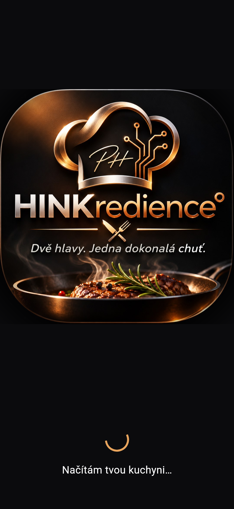
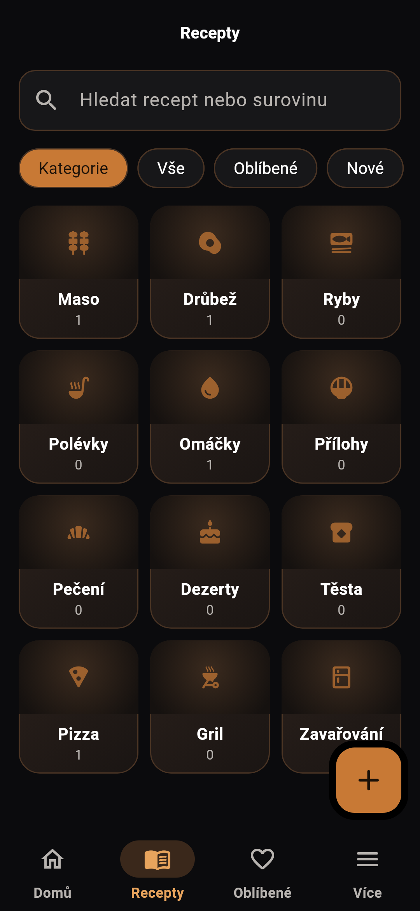
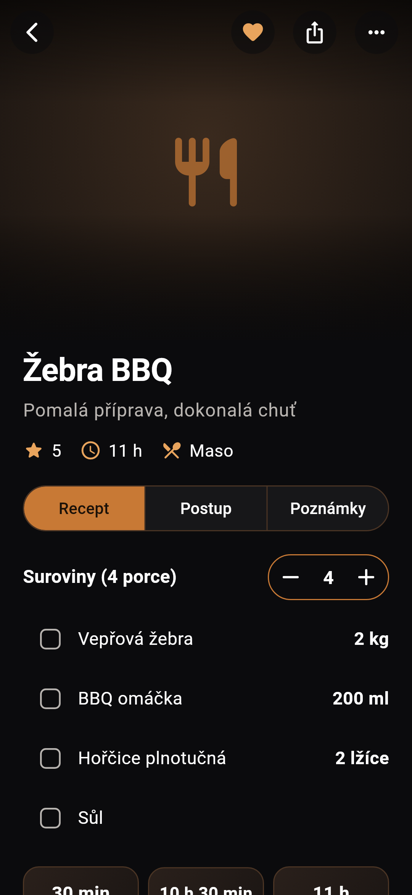

# HINKredience°

**Dvě hlavy. Jedna dokonalá chuť.**

Osobní inteligentní kuchařka Pavla Hinka pro Android a iOS. Flutter aplikace
s místní databází v telefonu a synchronizací přes Supabase.

| Úvod | Domů | Kategorie | Detail receptu |
| --- | --- | --- | --- |
|  |  |  |  |

Snímky generuje přímo z aplikace `flutter test tool/screenshots --update-goldens`
(v testovacím prostředí bez fotografií jídel a emoji).

## Stav projektu

| Etapa | Obsah | Stav |
| --- | --- | --- |
| 1 – Funkční základ | Flutter projekt, design, přihlášení, databáze, recepty, fotografie, synchronizace | **hotovo** (viz níže, co je a není ověřeno) |
| 2 – AI a vyhledávání | AI kuchař, chat, vyhledávání receptů na internetu, import | nezačato |
| 3 – Propojení s ChatGPT | zabezpečené API, MCP server | nezačato |
| 4 – Pokročilé funkce | deník, režim Vaříme spolu, rodinné účty, plán, nákupní seznam | nezačato (databáze je připravená) |

### Co umí Etapa 1

- Úvodní obrazovka s logem, hlavní obrazovka s oslovením, hledáním a doporučenými recepty.
- Recepty: vytvoření, úprava, koš a obnovení, duplikace, oblíbené, hodnocení,
  vlastní kategorie, hledání bez ohledu na diakritiku (i podle surovin), filtry.
- Detail receptu s přepočtem porcí, odškrtáváním surovin, postupem po krocích
  (čas a teplota u kroku), poznámkami a historií verzí.
- Každá úprava receptu uloží novou verzi; původní stav zůstává zachován.
- Fotografie z galerie i fotoaparátu.
- Sdílení receptu jako textu a export do souboru JSON.
- Funguje bez internetu i bez účtu – zdrojem pravdy je databáze v telefonu.
- Přihlášení e-mailem a heslem (Supabase Auth), obousměrná synchronizace
  receptů, historie verzí a fotografií.
- Funkce dalších etap jsou na hlavní obrazovce označené „Brzy“ a po klepnutí
  vysvětlí, kdy přijdou. Žádné tlačítko nepředstírá, že něco dělá.

### Co je ověřeno a co ne

Ověřeno automatickými testy při každém sestavení (GitHub Actions):

- přepočty porcí, formátování, vyhledávání, převody dat, česká diakritika,
- místní databáze: ukládání, verze, koš, duplikace, převzetí receptů po přihlášení,
- synchronizace proti serveru v paměti: odeslání, stažení, konflikty,
  výpadek připojení, nahrání fotografií,
- obrazovky (widget testy): domů, recepty, oblíbené, detail, více,
- databázová oprávnění: skutečné migrace běží v PostgreSQL (PGlite) a testy
  ověřují, že si uživatelé navzájem nevidí data.

**Neověřeno – potřebuje vaše ruce:**

- Synchronizace a přihlášení proti skutečnému projektu Supabase z telefonu.
  Projekt běží, migrace jsou spuštěné a API odpovídá (nepřihlášený přístup
  k datům je odmítnut), ale registrace a synchronizace ze skutečného
  zařízení ještě nebyla vyzkoušena.
- Chování na skutečném telefonu (fotoaparát, galerie, sdílení).
- Sestavení pro iOS s podpisem – vyžaduje Mac a účet Apple Developer.

## Instalace do telefonu s Androidem

1. Otevřete v telefonu [Releases](https://github.com/hincep-lab/hinkredience/releases)
   (repozitář je soukromý, je potřeba být přihlášen k GitHubu).
2. U nejnovějšího sestavení stáhněte `hinkredience.apk`.
3. Otevřete stažený soubor a povolte instalaci z tohoto zdroje.

Každé sestavení má vyšší číslo verze a stejný podpis, takže novou verzi
nainstalujete přes starou a recepty v telefonu zůstanou.

## Supabase (účet, záloha, synchronizace)

Projekt Supabase **hinkredience** (`https://wjqpzoeheonjwdyyezhb.supabase.co`,
region West EU, plán Free) je založený a všechny čtyři migrace ze složky
[`supabase/migrations`](supabase/migrations) v něm jsou spuštěné
(16 tabulek se zapnutým RLS, soukromý bucket `recipe-photos`).

Adresa projektu a veřejný (*publishable*) klíč jsou výchozí hodnotou sestavení
v [.github/workflows/build.yml](.github/workflows/build.yml), takže APK
z Releases je k projektu připojené rovnou. Klíč `service_role` / *secret*
do aplikace ani do repozitáře nikdy nepatří.

1. V aplikaci se zaregistrujte e-mailem a heslem.
2. Potvrďte účet odkazem, který přijde e-mailem (stránka po kliknutí se
   nemusí načíst – účet je i tak potvrzený), a přihlaste se.
3. Recepty vytvořené bez účtu se po prvním přihlášení převezmou a odešlou.
4. Výchozí vybavení a chuťové preference Pavla Hinka vloží po přihlášení
   funkce `select public.seed_hink_defaults();` (obrazovka pro ně přijde v další etapě).

Pro jiný projekt Supabase spusťte migrace v jeho SQL Editoru v pořadí podle
názvu a nastavte v GitHubu secrets `SUPABASE_URL` a `SUPABASE_ANON_KEY`.

## Vývoj

Potřebujete [Flutter](https://docs.flutter.dev/get-started/install) 3.50 (stable).

```bash
flutter pub get
flutter run            # spuštění na připojeném telefonu nebo emulátoru
flutter analyze
flutter test           # na Linuxu vyžaduje balíček libsqlite3-dev

# testy databázových oprávnění
cd supabase/tests && npm ci && npm test
```

### Sestavení Android APK

```bash
flutter build apk --release \
  --dart-define=SUPABASE_URL=https://xxxx.supabase.co \
  --dart-define=SUPABASE_ANON_KEY=váš_veřejný_klíč
# výsledek: build/app/outputs/flutter-apk/app-release.apk
```

Totéž dělá automaticky GitHub Actions při každém pushi do `main`
([.github/workflows/build.yml](.github/workflows/build.yml)).

### Sestavení pro iOS

V tomto prostředí iOS aplikaci sestavit nelze – je k tomu potřeba macOS
a Xcode. Projekt je na to připravený:

1. Na Macu: `flutter pub get`, potom `open ios/Runner.xcworkspace`.
2. V Xcode u cíle *Runner* → *Signing & Capabilities* zvolte svůj tým.
   Identifikátor aplikace je `cz.hink.hinkredience`.
3. Spuštění na připojeném iPhonu: `flutter run --release`.
4. Balíček pro TestFlight / App Store: `flutter build ipa --release`
   a nahrání přes Xcode nebo aplikaci Transporter.

Kontrolní sestavení bez podpisu (ověří, že se iOS část přeloží) spustíte
v GitHubu ručně přes **Actions → build → Run workflow**, nebo commitem,
jehož zpráva obsahuje `[ios]`.

## Architektura

```
lib/
  main.dart              start: nastavení, Supabase, složka pro fotky
  app/                   konfigurace, stav aplikace (Riverpod), navigace (GoRouter)
  core/                  design systém: barvy, motiv, společné komponenty, formátování
  data/                  model receptu, místní databáze, synchronizace, fotografie
  features/              obrazovky: splash, auth, home, recipes, more, shell
supabase/
  migrations/            SQL migrace: schéma, RLS, úložiště, výchozí data
  tests/                 testy oprávnění nad skutečnými migracemi
test/                    unit a widget testy aplikace
tool/make_icons.py       generování ikony a obrázků z loga
```

- **Offline-first.** Aplikace čte a zapisuje jen do SQLite v telefonu.
  Synchronizace běží na pozadí: nejdřív stáhne změny, potom odešle místní.
  Při konfliktu vyhrává poslední úprava; historie verzí se nikdy nepřepisuje.
- **Každý účet má vlastní databázi v telefonu**, data dvou uživatelů jednoho
  zařízení se nesmíchají.
- **Zabezpečení** je na straně databáze (Row Level Security). V aplikaci není
  žádný tajný klíč.

## Potřebné služby a provozní náklady

Ceny se mění – před rozhodnutím ověřte aktuální ceníky.

| Služba | K čemu | Cena (stav 11/2026) |
| --- | --- | --- |
| GitHub | zdrojový kód, sestavení APK | zdarma; soukromé repozitáře mají měsíční limit minut Actions |
| [Supabase](https://supabase.com/pricing) | databáze, účty, fotografie | Free 0 USD (500 MB databáze, projekt se po 7 dnech nečinnosti uspí); Pro od 25 USD měsíčně |
| Apple Developer Program | instalace na iPhone, TestFlight | 99 USD ročně |
| Google Play (volitelné) | vydání v obchodě | jednorázový registrační poplatek |
| OpenAI API (Etapa 2) | AI kuchař | platba podle spotřeby |
| Vyhledávací API (Etapa 2) | hledání receptů na internetu | podle zvolené služby |

Pro rodinnou kuchařku plán Supabase Free kapacitně stačí. Počítejte ale
s uspáváním nečinného projektu: po týdnu bez použití je potřeba ho
v administraci znovu probudit, jinak synchronizace neproběhne (recepty
v telefonu fungují dál).

## Poznámky k bezpečnosti

- Soubor `android/key.properties` a klíč `android/app/hinkredience-sideload.jks`
  jsou v repozitáři záměrně, aby každé sestavení mělo stejný podpis a šlo
  aktualizovat bez odinstalace. Repozitář proto nechte soukromý. Před vydáním
  do Google Play si vytvořte vlastní klíč a uložte ho mimo repozitář.
- Veřejný klíč Supabase (*anon*) tajný není; přístup k datům řídí RLS.

---

© Pavel Hink
